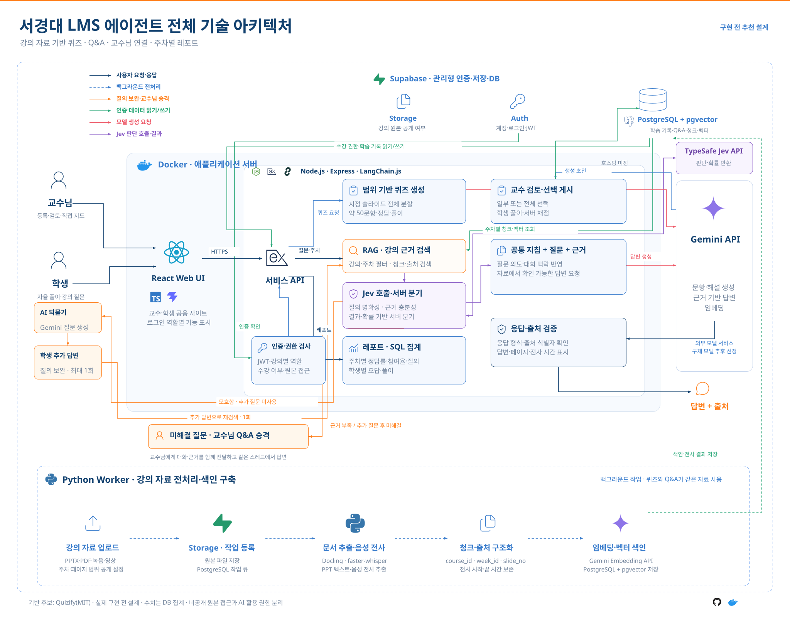

# 서경대 Campus LMS Agent

강의 자료로 자율 학습 퀴즈와 Q&A를 제공하고, 교수님이 필요한 질문에 직접 개입하도록 돕는 프로젝트다. 교수·학생은 같은 사이트를 사용한다.

**현재: PDF/PPTX 퀴즈의 첫 기능을 로컬에서 구현했다.** 자료·페이지 범위 등록, AI 문제 생성, 교수 선택 게시, 학생 풀이, 서버 채점과 개인 오답 확인을 제공한다. 주차 Q&A, Jev 판단 어댑터, 추가 질문 1회와 교수 답변도 구현했다. 실제 Claude API·Jev 연결도 검증했으며, 교수 주차별 퀴즈·Q&A 레포트, 녹음·동영상 자동 전사와 시간 출처도 제공한다. Supabase 실서비스 연동은 다음 단계다.

## 로컬 실행

Node.js 24.13 이상과 Python 3.9 이상이 필요하다.

```bash
npm ci
python3 -m venv .venv-worker
source .venv-worker/bin/activate
python -m pip install -r worker/requirements.txt
cp .env.example .env
```

`.env`의 `PYTHON_BIN`을 가상 환경 Python의 절대 경로로 설정한다. 예: `<저장소 절대경로>/.venv-worker/bin/python`.

기본 생성 제공자는 **Claude API**다. `.env`에 `AI_PROVIDER=claude`, `ANTHROPIC_API_KEY`, `ANTHROPIC_MODEL=claude-sonnet-5-5`를 설정한다. Q&A 판단에는 별도 `TYPESAFE_API_KEY`가 필요하다. 비밀키는 서버에서만 읽으며 Git·브라우저에 전달하지 않는다.

```bash
npm run dev
```

[로컬 학습실](http://127.0.0.1:5173)에서 교수 체험으로 자료를 등록한다. 생성·검토·게시 후 로그아웃하고 학생 가/나로 풀이와 개인 오답을 확인한다. **강의 Q&A** 탭에서 학생 질문·추가 답변과 교수 답변을 확인한다. 첫 실행에는 데이터베이스 강의 1개와 주차 2개를 제공한다. 원본·결과는 `.data/`에 저장하고 Git에는 올리지 않는다.

현재는 **로컬 시연용** 앱이다. 체험 계정은 실제 학교 인증이 아니며 서버는 `127.0.0.1`에만 바인딩한다. Claude API는 [공식 Messages SDK](https://github.com/anthropics/anthropic-sdk-typescript)의 구조화 출력을 사용한다. API 잔액과 사용 한도를 따른다.

## 생성 제공자와 Q&A 판단

Claude는 퀴즈·Q&A 답변·보완 질문을 생성하고 **Jev는 질문 명확성과 검색 근거 충분성만 판단**한다. 기본 Claude 모델은 `claude-sonnet-5-5`이며 `ANTHROPIC_MODEL`로 변경할 수 있다. 응답의 문항 수·정답 형식·출처 범위는 서버에서 추가 검사한다.

로컬 CLI를 명시적으로 선택하려면 `AI_PROVIDER=codex`와 `codex login`을 사용한다. 이 모드는 연결한 ChatGPT 계정의 사용 한도를 따르며 임시 폴더·읽기 전용·셸 및 하위 에이전트 비활성화로 실행한다. Claude 오류나 키 누락 시 자동으로 Codex에 대체 호출하지 않는다. 선택적 `openai`·`gemini` 어댑터는 퀴즈만 지원하며 이 설정에서 Q&A 생성은 미지원 오류로 남긴다.

`.env`의 `JEV_MODEL=jev-1.13.0`, `JEV_MIN_CONFIDENCE=0.75`는 소수 사례 검증용 설정이다. Jev는 [공식 TypeSafe SDK](https://github.com/typesafe-ai/typesafe-sdk-js)로 두 판단을 한 번에 요청한다. 실제 한국어 사례의 분기는 확인했지만 정확도·임계값을 대규모 평가한 것은 아니다. Jev confidence는 답변의 정답 확률이 아니다.

Jev는 유료 API다. 확인일인 2026-10-21의 [공식 요금](https://docs.typesafe.ai/models)은 입력 100만 토큰당 $0.042, 출력 무료다. 무료 체험이나 크레딧 제공은 보장하지 않는다. Claude는 별도 API 요금이 적용된다.

현재 검색은 같은 강의·주차의 완료된 PDF/PPTX 지정 페이지와 녹음·동영상 전사를 대상으로 하는 단어 검색이다. 원본이 비공개여도 허용된 AI 처리는 가능하다. 벡터 검색은 후속 구현이다.

- 명확하고 근거가 충분하면 페이지 또는 전사 시간 출처와 함께 답변한다.
- 모호하면 추가 질문을 한 번만 보낸다. 학생 답변 뒤 다시 검색·판단하며, 여전히 모호하면 교수님에게 넘긴다.
- 명확하지만 근거가 부족하거나 판단이 불확실하면 교수님에게 넘긴다. 교수님은 같은 탭에서 직접 답변한다.
- API 연결 실패는 오류로 보존하고 명시적 재시도를 제공한다. 오류를 교수님 승격으로 바꾸지 않는다.
- 학생은 본인의 대화만 볼 수 있다. 대화·횟수·판단 기록은 재시작 후에도 보존한다.

키가 없으면 오류로 표시한다. 실행 코드에서 다른 모델이나 테스트 응답으로 판단·생성을 대체하지 않는다.

## 강의 녹음·동영상

교수의 **녹음·동영상** 탭에서 파일을 올리면 자동 전사하고 같은 주차 Q&A에 시간 출처로 사용한다. 공개한 원본은 답변의 시간 구간부터 재생할 수 있고 비공개 원본·전체 전사는 학생에게 제공하지 않는다. 교수는 전사 확인·재생·실패 재시도를 할 수 있다.

로컬 전사에는 ffmpeg/ffprobe와 `worker/requirements-media.txt`를 설치한 Python이 필요하다. `.env`의 `PYTHON_BIN`을 해당 가상 환경의 실행 경로로 지정한다. 기본 faster-whisper small·CPU int8을 사용하고 최초 모델 다운로드 후 캐시한다. 별도 전사 API 키는 없다. 파일은 500MB·120분 이하이며 영상은 음성 트랙을 사용한다. [설치·권한·작업 처리·검증](docs/media.md)

YouTube 공개 영상도 **녹음·동영상 → YouTube 강의 연결**에서 등록할 수 있다. 링크의 시작 시간을 반영하고 끝 시간을 지정하면 해당 구간만 주차 Q&A 근거로 사용한다. 자막 우선·음성 전사 대체와 원본 시간 출처, 공개 여부에 따른 YouTube 이동을 제공한다. [설치·권한·지원 범위](docs/youtube.md)를 따른다.

## 교수 레포트

교수로 로그인한 뒤 **수업 레포트** 탭에서 주차를 선택한다. 전체 선택, 주차별 퀴즈 참여율·정답률·문항별 정답과 풀이, Q&A 상태 집계·전체 대화를 볼 수 있다. Q&A 목록은 페이지를 나누어도 전체 질문 수로 집계한다. 학생과 다른 강의 교수는 API에서도 차단한다.

참여율은 현재 수강생 중 게시 퀴즈를 하나 이상 제출한 고유 학생의 비율이다. 정답률은 실제 제출 답안 전체의 정답 비율이며 전체 기간은 분자·분모를 합산한다. 미제출은 오답이 아니고 분모가 없으면 —로 표시한다. 집계 기준을 화면에서 확인할 수 있다. 레포트 조회는 모델을 다시 호출하지 않는다. [계산 기준·API·제약](docs/reports.md)

## 첫 기능의 범위

- PDF/PPTX 한 개의 물리 페이지 범위를 지정한다. 페이지 번호는 1부터, 양 끝을 포함한다.
- 원본 공개 여부를 별도로 정한다. 비공개 원본도 문제 생성에 사용할 수 있다.
- 문서의 실제 페이지 순서를 유지하고, 1~50개의 객관식 문제를 최대 8개씩 나누어 생성한다. 범위 전체를 보내며 출처·형식·문자열 기준 중복 문항을 검증한다. 의미가 비슷한 문항은 교수 검토로 걸러야 한다.
- 교수님이 일부 또는 전체 문항을 선택해 게시한다. 한 초안은 한 번 게시한다.
- 학생에게는 게시된 문항의 문제와 보기만 제공한다. 서버 채점 후 본인의 오답·정답·풀이·페이지 출처를 제공한다.
- 퀴즈별 학생 제출은 1회다. 동일 요청 키의 재전송은 기존 결과를 반환한다.
- 서버를 다시 시작해도 게시·개인 결과를 보존한다. 진행 중 끊긴 작업은 실패로 표시한다.

문서 지원 제한: 파일 하나 20MB, 최대 500페이지. 구형 `.ppt`, 스캔 PDF/OCR, 그림·수식의 시각적 이해, 영상 화면·판서 인식, 배포용 인증·DB·RLS는 미구현이다. 모델이 생성한 정답의 내용상 정확성은 교수 검토가 필요하다.

## 전체 기술 아키텍처



[Figma 편집 원본](https://www.figma.com/design/9W3QknQCIXbrdoy0yvCldZ?node-id=560-2) · [SVG 원본](docs/assets/architecture.svg) · [내보내기 정보](docs/assets/architecture.source.json)

위 이미지는 Figma에서 직접 내보낸 전체 목표 설계다. **그림의 생성 모델 Gemini는 이후 사용자 요청으로 GPT를 거쳐 Claude API로 변경되었다. 현재 기본은 Claude 생성·Jev 판단이다.** 그림의 Supabase 등 전체 구성이 이미 구현된 것은 아니다. 현재 동작과 목표 설계의 차이는 [구현 현황](docs/implementation.md)을 참조한다.

## 협업과 검증

[역할별 이슈](https://github.com/2026-sku-campusthon/campus-lms-agent/issues) · [개발 순서](docs/development-plan.md) · [AI 협업 지침](AGENTS.md) · [API 계약](docs/contracts/openapi.yaml) · [검증 기록](docs/verification.md)

```bash
npm run typecheck
npm test
npm run build
npx playwright install chromium
npm run test:e2e
```

검사 명령도 Python 가상 환경을 활성화한 셸에서 실행한다. 브라우저 자동 검사는 실제 문서 처리를 호출하되 모델 응답은 테스트 대역이다. 실제 모델 호출과 구분한다. `scripts/verify-live-flow.ts <파일 경로> [문항 수] [시작 페이지] [끝 페이지]`는 설정한 실제 제공자로 생성·게시·채점을 검증하며 로컬 `.data/`에 결과를 남긴다.

`node --import tsx scripts/verify-live-qa.ts`는 등록된 실제 첫 주차 자료를 읽어 임시 DB에서 실제 Jev·생성 제공자의 답변·추가 질문·승격·교수 답변을 검사한다. 실제 API 비용이 발생하며 메타데이터만 `.data/live-qa-verification.json`에 저장한다.

계약 검사는 `requirements-contracts.txt`를 설치한 Python으로 `scripts/check_contracts.py`를 실행한다. [기획·페르소나](docs/product.md) · [기술 선택과 재사용 검토](docs/architecture.md) · [AI 협업 방법](docs/coordination.md)
