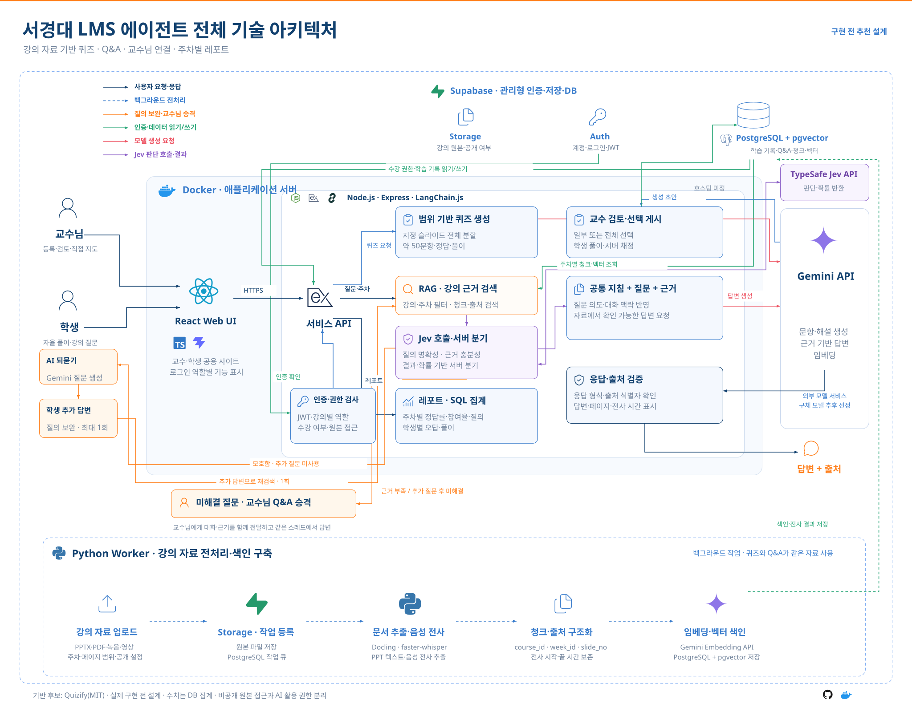

# GitHub 참고 프로젝트와 추천 기술 아키텍처

> **최신 결정 (2026-10-22):** Supabase를 사용하지 않는다. MySQL 8.4에 실제 계정·서버 세션·학습 기록을 저장하고 비공개 강의 원본은 영구 볼륨에 둔다. Oracle Cloud Ubuntu 인스턴스에서 React 정적 파일+Express/Python 앱, MySQL, Caddy HTTPS를 Docker Compose로 실행한다. Claude 생성·Jev 판단은 유지한다. 아래 조사·Figma SVG는 이전 목표 설계이며 최신 구현/배포는 [구현 현황](implementation.md)과 [배포 안내](deployment.md)를 따른다.

> **YouTube 구현 후속 (2026-10-22):** 같은 주차의 공개 영상 링크·시간 구간 입력, 자막 우선 수집·음성 ASR 대체와 시간 출처를 로컬에 구현했다. 현재 API는 0.6.0-youtube.1이며 세부 동작은 [YouTube 명세](youtube.md)를 따른다. Figma 원본 SVG는 이 후속 입력을 별도로 반영하지 않았다.

> **구현 업데이트 (2026-10-21):** 사용자 요청으로 기본 생성을 Claude API로 변경했다. 실제 Claude 퀴즈와 Jev·Claude Q&A의 답변·추가 질문 1회·교수 승격·교수 답변을 소수 사례로 확인했다. 현재 검색은 단어 기반이며 로컬 faster-whisper 음성 전사·시간 출처를 구현했다. 임베딩·Supabase는 미구현이다. Figma SVG는 이전 Gemini 표시가 남은 원본이다. 현재 동작과 차이는 [구현 현황](implementation.md)을 따른다.


관련 기획: [기획과 페르소나](product.md)

> 2026-10-21 대화에서 조사한 GitHub 프로젝트와 이를 바탕으로 제안한 설계를 기록했다. 저장소 README·라이선스·일부 소스 코드를 확인했으며, 로컬 설치·실행과 기능 재현은 아직 검증하지 않았다. 아래 기술 선택은 구현을 위한 추천안이며 실제 구현·배포 상태가 아니다.

## 해결할 핵심 문제

학생의 이해와 자발적인 학습을 돕고 싶은 교수님은 학생들이 어떤 개념에서 막히는지 파악하기 어렵고, 복습 자료 준비와 개별 질의응답에도 시간이 들어 필요한 지도를 적시에 제공하는 데 어려움을 겪는다.

교수님의 학습 지원을 중심으로 퀴즈, 강의 자료 기반 Q&A, 교수님 연결, 주차별 레포트를 하나의 사이트에 구성한다. 사용자 결정에 따라 인터뷰 없이 현재 정의한 페르소나와 기능을 바탕으로 제작한다.

## 1. 참고 프로젝트 비교

| 프로젝트 | 확인한 기능 | 우리 서비스에서 활용할 부분 | 차이 및 한계 | 라이선스 |
| --- | --- | --- | --- | --- |
| [Quizify](https://github.com/aree6/Quizify) | PDF/PPTX 등록, AI 객관식 퀴즈, 교수 수정·확정, 학생 풀이·해설, 교수 분석 화면 | 첫 번째 아이디어의 웹·API·DB 구조를 우선 검증할 후보 | README는 5~20문제를 설명하지만 확인한 서버 코드는 최대 30문제로 제한한다. 주차·슬라이드 범위·50문제 선택 게시·강의 Q&A 확장이 필요 | [MIT](https://github.com/aree6/Quizify/blob/main/LICENSE) |
| [LearnHouse](https://github.com/learnhouse/learnhouse) | 강의·사용자 관리, 과제·퀴즈, 토론, 분석, AI 학습 지원 | LMS 전체 구성과 교수·학생 경험 참고 | 이번 프로젝트보다 범위가 크다. 일부 고급 분석·기업 기능의 제공 범위를 구분해야 한다 | AGPL-3.0, Enterprise 기능 별도 |
| [Open Notebook](https://github.com/lfnovo/open-notebook) | 문서·녹음·영상 입력, 자료 검색, 출처 기반 대화 | 강의 자료 수집·전사·Q&A 구조 참고 | 현재 단일 사용자 중심. 강의별 교수·학생 권한을 그대로 제공하는 LMS가 아니다 | MIT |
| [QuizWeaver](https://github.com/Robyn-Collie/QuizWeaver) | 퀴즈 초안, 교사 검토·수정, 문제은행, 학습 분석, 내보내기 | 교수의 문제 검토·수정 화면과 생성 흐름 참고 | 교사용 서비스. 학생용 풀이 서비스는 별도 구성해야 한다 | MIT |
| [Dify](https://github.com/langgenius/dify) | 문서 수집·검색, AI 워크플로, 외부 호출 API | AI 파이프라인을 빠르게 구성하는 대안 | 강의·수강생·채점·참여율·교수님 승격 상태는 우리 서비스에서 관리해야 한다 | [추가 조건이 있는 Dify 라이선스](https://github.com/langgenius/dify/blob/main/LICENSE) |

### Quizify를 우선 검증하는 이유

- React·Vite·TypeScript 프런트엔드와 Node.js·Express 백엔드를 사용한다.
- Supabase의 PostgreSQL·pgvector·Auth·Storage를 활용한다.
- 자료 등록, 문제 생성, 교수 확인, 학생 풀이, 결과 분석이 하나의 흐름으로 구성되어 있다.
- 소규모 저장소이므로 README의 기능 설명과 실제 동작을 설치·실행으로 대조해야 한다.
- 기존 코드를 가져올 경우 MIT 저작권·라이선스 고지를 유지한다.

### 소스 코드에서 확인한 수정 지점

- [rag.service.ts](https://github.com/aree6/Quizify/blob/main/backend/src/services/rag.service.ts): PPTX 슬라이드 텍스트를 하나로 합친다. 페이지 범위 선택을 위해 슬라이드 번호를 유지하도록 바꿔야 한다. 슬라이드 파일명의 문자열 정렬도 실제 발표 순서와 대조해야 한다.
- [quiz.service.ts](https://github.com/aree6/Quizify/blob/main/backend/src/services/quiz.service.ts): 학생 풀이·서버 채점·결과 조회 구조를 참고할 수 있다. 풀이 전 응답에도 해설이 포함되는 부분은 우리 오답 공개 시점에 맞게 수정한다.
- [auth.ts](https://github.com/aree6/Quizify/blob/main/backend/src/middleware/auth.ts): UTM 이메일 도메인과 역할 메타데이터에 의존한다. 서경대 서비스에서는 서버가 관리하는 강의별 역할과 수강 등록 관계로 대체한다.
- [mvp_schema.sql](https://github.com/aree6/Quizify/blob/main/supabase/mvp_schema.sql): 자료·청크·게시된 문제·풀이 기록에 공개 조회 정책이 포함된다. 특히 `quiz_attempts_read`는 `USING (true)`다. 우리 서비스의 수강생별 접근 제어에 맞게 초기 DB 정책을 다시 작성한다. 실제 배포 상태나 추가 마이그레이션의 적용 상태를 확인한 결과는 아니다.
- [courses.service.ts](https://github.com/aree6/Quizify/blob/main/backend/src/services/courses.service.ts): 생성 문항 수를 최대 30개로 제한하고 주제별 검색 결과로 강의·퀴즈를 생성한다. 50문항 생성과 지정 페이지 범위의 전체 개념 반영을 위해 생성 흐름을 바꾼다.

### 추가 참고 문서

- [LearnHouse 학생 AI](https://docs.learnhouse.app/platform/ai/for-students)
- [LearnHouse 교사용 AI](https://docs.learnhouse.app/platform/ai/for-teachers)
- [LearnHouse 분석 API](https://docs.learnhouse.app/reference/analytics): 일부 분석은 플랜 및 외부 분석 백엔드 조건이 있다.
- [Open Notebook 자료 입력](https://github.com/lfnovo/open-notebook/blob/main/docs/3-USER-GUIDE/adding-sources.md): 음성·영상은 STT 모델로 전사한다.
- [Open Notebook 방향](https://github.com/lfnovo/open-notebook/blob/main/VISION.md): 현재 단일 사용자 중심이라고 명시한다.

## 2. 추천 구현 방향

**Quizify 구조를 우선 실행 검증하고, 필요한 기능을 수정·추가한다.** 여러 완성형 제품을 모두 동시에 운영하는 구성은 기본안에 포함하지 않는다.

- 기본 웹과 API는 React·Vite·TypeScript, Node.js·Express를 유지하는 안이다.
- 자료 추출과 긴 음성 전사는 Python Worker에서 실행한다.
- DB·계정·파일 저장·벡터 검색은 Supabase 중심으로 모은다.
- Q&A 검색 뒤에 TypeSafe Jev를 호출하여 질문의 명확성과 검색 근거의 충분성을 각각 판단한다. 사용자가 Q&A 판단 구간에 Jev 도입을 결정했다.
- 생성은 Claude API를 사용한다. 임베딩 모델은 미정이며 현재 코드는 단어 검색이다. Claude를 임베딩 제공자로 확정한 것은 아니다.
- Quizify에 설정된 기존 생성 제공자와 다른 선택이므로 모델 호출·환경 설정은 수정해야 한다.
- MVP에서는 PostgreSQL의 작업 테이블을 Worker가 조회하는 방식으로 시작한다. 별도의 Redis를 필수로 추가하지 않는다.
- Dify는 자체 AI 코드를 줄이고 싶을 때 선택할 대안이며, 기본 구성과 함께 필수로 운영하는 서비스가 아니다.

## 3. 전체 기술 아키텍처



- [Figma 편집 프레임](https://www.figma.com/design/9W3QknQCIXbrdoy0yvCldZ?node-id=560-2)
- [벡터 원본 SVG](assets/architecture.svg)
- 참고한 구성: 같은 Figma 파일의 출력 페이지 16p ‘KotaTech 전체 기술 아키텍처’. 기존 16p는 수정하지 않고 출력 페이지 오른쪽에 별도 프레임을 추가했다.
- 첨부 참고 이미지의 구성에 맞춰 시스템 흐름형으로 재구성했다. 독립 기술 로고, Docker 서버와 Node.js 프로세스 경계, 상단 관리형 DB, 우측 외부 모델, 하단 Python Worker 전처리 파이프라인을 배치했다. 주황색 경로는 추가 질문 1회와 교수님 승격을 나타낸다.

| 계층 | 추천 기술 | 담당 기능 |
| --- | --- | --- |
| 웹사이트 | React, Vite, TypeScript | 교수·학생이 하나의 사이트를 사용하고 강의별 역할에 따라 기능을 표시한다 |
| 서비스 API | Node.js, Express | JWT 검증, 강의별 권한 검사, 게시, 채점, Q&A 상태 관리, 레포트 조회 |
| 자료 처리 | Python Worker, Docling, faster-whisper | PPTX·PDF 추출, 녹음·영상 음성 전사, 페이지·시간 정보 보존 |
| AI 검색·생성 | 단어 검색, Claude API | 주차별 근거 검색, 문항·해설·답변·추가 질문 생성. 벡터 검색·임베딩은 후속 구현 |
| Q&A 판단 | TypeSafe Jev API | 질문 명확성·검색 근거 충분성 판단. 결과와 확률을 서버 분기 규칙에 전달 |
| 인증 | Supabase Auth | 사용자 계정, 로그인, JWT 발급 |
| 파일 저장 | Supabase Storage | 강의 원본, 녹음·영상, 원본 공개 설정에 따른 접근 제어 |
| 관계형·벡터 DB | PostgreSQL, pgvector | 강의·수강·문항·답안·질의·청크·임베딩·작업 큐 |
| 실행·협업 | Docker, GitHub | 코드 버전 관리, API·Worker 실행 환경 구성. 실제 호스팅은 미정 |

Express 내부 기능은 하나의 API 애플리케이션 안의 모듈이다. 각 기능을 별도 마이크로서비스로 배포하는 설계가 아니다.

## 4. 공통 자료 처리 흐름

1. 교수님이 강의·주차·PPT 페이지 범위와 자료 공개 여부를 지정한다.
2. 원본을 Storage에 저장하고 DB에 처리 작업을 등록한다.
3. Python Worker가 작업을 가져와 PPTX·PDF 텍스트와 음성 전사 결과를 추출한다.
4. `course_id`, `week_id`, `material_id`, `slide_no`, `start_sec`, `end_sec` 등 자료에 해당하는 출처 정보를 보존한다.
5. 텍스트 청크와 임베딩을 저장한다. 퀴즈와 Q&A는 이 자료를 공유한다.
6. 긴 전사는 요청이 끝날 때까지 기다리게 하지 않고 처리 상태를 화면에 표시한다.

[Docling](https://github.com/docling-project/docling)은 PPTX·PDF 등 문서 추출 후보이고, [faster-whisper](https://github.com/SYSTRAN/faster-whisper)는 음성 전사와 시간 정보 추출 후보이다. 첫 구현에서 영상 입력은 음성 전사를 기준으로 하며, 영상 속 화면·판서까지 이해하는 기능은 별도 범위다. `.pptx`를 기본 입력으로 하고 구형 `.ppt` 변환 지원은 추가 검토한다.

## 5. 퀴즈 흐름

1. 지정된 슬라이드 범위를 모두 읽고, 길면 구간별로 나누어 문제를 생성한다.
2. 약 50개의 문항·정답·풀이·출처를 구조화된 초안으로 저장한다.
3. 교수님이 문제를 검토하여 일부 또는 전체를 선택·게시한다.
4. 학생은 자율적으로 게시된 퀴즈를 푼다.
5. 정답은 서버에서 비교한다. 학생에게는 제출 후 자신의 오답과 풀이를 보여준다.
6. 교수님 레포트는 학생 답안과 수강생 명단을 기반으로 집계한다.

범위 전체의 개념 문제를 만들 때는 질문 하나로 검색한 상위 몇 개 청크만 사용하지 않는다. 지정 범위를 분할·배분하여 범위 누락을 줄인다.

## 6. Q&A 흐름과 교수님 승격 — Jev 반영

**결정: Jev는 Q&A 판단, Claude는 답변·추가 질문 생성, 서버 코드는 횟수 제한과 상태 전환을 담당한다.**

1. 서버가 로그인한 학생의 강의·주차·접근 권한을 검사한다.
2. LangChain.js와 pgvector로 해당 강의·주차의 자료에서 관련 청크와 출처를 검색한다.
3. 학생 질문, 직전 대화, 검색한 자료를 Jev에 보내 질문 명확성과 근거 충분성을 각각 판단한다.
4. 서버가 판단 결과와 추가 질문 횟수를 함께 확인하고 아래 규칙으로 분기한다.
5. 학생의 추가 답변은 같은 스레드에 저장하고, 보완한 질의로 다시 검색한 뒤 Jev 판단을 반복한다.
6. 교수님 답변과 처리 상태를 같은 스레드에 저장한다.

### 역할 분리

| 구성 요소 | 담당 역할 |
| --- | --- |
| LangChain.js + pgvector | 권한과 강의·주차 범위에 맞는 근거를 검색한다 |
| TypeSafe Jev API | 질의 명확성·검색 근거의 충분성에 대한 제한된 판단과 확률을 반환한다 |
| Claude API | 확인한 근거를 바탕으로 답변하거나, 질의를 명확히 할 추가 질문을 생성한다 |
| Express 서버 | 판단 결과를 해석하고 추가 질문 1회 제한·교수님 승격·DB 상태 전환을 수행한다 |

### 서버 분기 규칙

| 상황 | 처리 |
| --- | --- |
| 질문이 명확하고 근거가 충분함 | Claude가 근거 기반 답변을 생성하고 페이지 또는 전사 시간 정보를 표시한다 |
| 질문이 모호하고 추가 질문을 아직 하지 않음 | Claude가 추가 질문을 생성하고 `awaiting_student`로 전환한다 |
| 한 번 추가 질문한 뒤에도 질의를 이해하기 어렵거나 답변 근거가 부족함 | 대화와 검색 근거를 보존하고 `awaiting_professor`로 승격한다 |
| 질문은 이해했지만 검색 결과에서 충분한 답변 근거를 확보하지 못함 | `awaiting_professor`로 승격한다. 검색 실패가 자료 전체에 답이 없다는 증명은 아니다 |

제안 상태는 `open`, `awaiting_student`, `awaiting_professor`, `resolved`다. 추가 질문 횟수는 서버가 스레드별로 관리한다. 학생의 추가 답변 자체가 즉시 승격을 의미하지 않으며, 다시 검색·판단한 결과로 분기한다.

### Jev 입력·출력과 기록

- 입력: 학생 질문, 관련 대화, 강의·주차가 확인된 검색 청크와 출처 식별자. 전체 PPT나 원본 녹음 파일을 직접 보낼 필요는 없다.
- 질문: “학생이 무엇을 묻는지 구체적으로 알 수 있는가?”, “제공한 근거가 이 질문에 답하는 데 충분한가?”처럼 두 판단을 분리한다.
- 출력: 구조화된 판단과 확률. Jev는 최종 답변이나 추가 질문 문장을 생성하는 역할이 아니다.
- DB 기록 제안: 판단 결과·확률·사용 모델 버전·근거 ID·추가 질문 횟수·서버가 선택한 경로. 수치와 판단 기준은 향후 구현에서 확정한다.
- 임계값은 실제 한국어 강의 질문으로 검증한 후 정한다. 모델 확률은 정답 보증이 아니며, Jev 호출 실패나 판단 불확실성을 처리할 서버 경로도 구현한다.
- 현재 Jev 도입 범위는 Q&A 판단이다. PPT 자동 분류나 퀴즈 품질 판정에는 아직 추가하지 않는다.

### 공식 참고 자료

- [Jev 소개](https://docs.typesafe.ai/introduction): 구조화된 질문과 결과
- [검색 자료 선별](https://docs.typesafe.ai/cookbooks/classifying_rag_passages): 검색과 생성 사이 판단 단계
- [판단 결과에 따른 분기](https://docs.typesafe.ai/patterns/confidence-routing): 코드가 분기와 임계값을 관리하는 방식
- [모델·언어 지원](https://docs.typesafe.ai/models): 한국어 작업은 자체 검증 필요
- [공식 JavaScript SDK](https://github.com/typesafe-ai/typesafe-sdk-js): Express 서버 연동 후보

## 7. 레포트와 접근 권한

- 교수용 퀴즈 레포트: 선택 주차 또는 전체 주차의 문제·문항별 정답률·참여율.
- 학생용 레포트: 로그인한 학생 자신의 오답과 풀이.
- 교수용 Q&A 레포트: 주차별 학생 질의 내역. 요약 등 추가 항목은 추후 확정한다.
- 집계 수치는 SQL과 코드로 계산한다. AI가 수치를 추정하지 않는다.
- 참여율은 예를 들어 ‘해당 주차 퀴즈 제출 학생 수 / 해당 주차 참여 대상 수강생 수’로 정의할 수 있다. 최종 기준과 재응시 처리 방식은 구현 전에 확정한다.
- 서버의 강의별 권한 검사와 DB 정책으로 다른 강의·다른 학생 데이터 접근을 제한한다.
- 교수님이 허용한 AI 처리와 원본 파일의 학생 공개 여부는 별도 설정으로 취급한다.

## 8. 구현 순서

팀 인원 4명, 개발 마감일 2026-10-31, 각 팀원이 AI를 사용한다는 조건을 반영한 구체 계획은 아래 **10. 재사용 범위·4인 역할·개발 일정**을 따른다. 2026-10-30을 내부 검증 완료 목표로 두고 10월 31일은 제출·시연과 최종 수정에 사용한다.

## 9. Figma 원본과 로고

이 저장소의 `assets/architecture.svg`는 Figma 파일의 `560:2` 프레임을 직접 SVG로 내보낸 결과다. 별도로 재구성한 SVG가 아니다. 내보내기 정보와 SHA-256은 [architecture.source.json](assets/architecture.source.json)에 기록한다. Figma 수정 사항은 재내보내기 전까지 저장소 이미지에 자동 반영되지 않는다.

일반 기능 아이콘은 [Lucide](https://github.com/lucide-icons/lucide), 기술 로고는 [Simple Icons](https://github.com/simple-icons/simple-icons) 원본을 사용했다. 관련 출처와 고지는 [NOTICE](../NOTICE.md)를 따른다. 로고 표시는 공식 제휴를 의미하지 않는다.

## 10. 재사용 범위·4인 역할·개발 일정

### 계획 조건과 현재 검증 범위

- 팀원은 4명이며 각자 개발용 AI를 사용한다.
- 개발 마감일은 2026-10-31이다. 날짜는 한국 시간 기준이다.
- 이번 계획은 저장소의 일부 소스를 추가 확인한 결과다. Quizify를 실제 설치·실행한 결과는 아직 아니다.
- 확인한 Quizify 소스 기준 커밋: `4b9214e89011ae65b5b9603b0ea176d744aa8e48`. 구현을 시작할 때 재사용 기준 커밋과 의존성 버전을 고정한다.
- 기본 전략은 Quizify를 후보 기반으로 삼고, 라이브러리·서비스로 해결할 부분과 우리 서비스 규칙을 구분하여 추가하는 것이다.

### 10-1. 라이브러리·서비스를 사용하고 연결 코드를 작성할 부분

| 구성 요소 | 가져올 대상 | 우리가 작성할 연결 코드 |
| --- | --- | --- |
| 계정·로그인 | Supabase Auth | 계정과 강의별 교수·수강생 관계 연결, 서버 JWT 확인 |
| 파일 저장 | Supabase Storage | 원본 공개 여부, 저장 경로, 권한 확인 후 다운로드 |
| 관계형·벡터 DB | PostgreSQL + pgvector | 강의·주차·문항·대화 스키마, 검색 함수, 접근 정책 |
| 문서 추출 | [Docling](https://github.com/docling-project/docling) | PPT 페이지 범위 지정, 페이지별 추출 결과 정규화, 실패 처리 |
| 음성 전사 | [faster-whisper](https://github.com/SYSTRAN/faster-whisper) | 녹음·영상 업로드 작업, 전사 시간 정보, 처리 상태·재시도 |
| 생성 | Claude API | 생성 지침, 문항·답변 구조 검증, 호출 오류·재시도 |
| Q&A 판단 | [공식 TypeSafe JS SDK](https://github.com/typesafe-ai/typesafe-sdk-js) | Jev 질문·판정 기준, 판단 로그, 호출 실패 처리 |
| 검색 구성 | LangChain.js | 강의·주차·페이지 필터, 검색 질의·출처 조립 |

라이브러리를 사용해도 작업 큐·화면·권한·도메인 규칙까지 자동으로 구현되는 것은 아니다. 표의 연결 코드는 우리 구현 범위다.

### 10-2. Quizify에서 수정하여 재사용할 후보

아래 파일은 실제 저장소에서 존재와 주요 역할을 확인했다. 재사용 여부는 10월 22일까지 실행과 코드 적합성을 확인해 최종 결정한다.

| 기능 | 확인한 파일 | 유지할 부분 | 바꿀 부분 |
| --- | --- | --- | --- |
| 자료 관리 화면 | [Materials.tsx](https://github.com/aree6/Quizify/blob/4b9214e89011ae65b5b9603b0ea176d744aa8e48/frontend/src/pages/Materials.tsx) | 업로드·자료 목록 구성 | 주차·페이지 범위·원본 공개 여부·처리 상태 |
| 문제 생성·미리보기 | [CreateCourse.tsx](https://github.com/aree6/Quizify/blob/4b9214e89011ae65b5b9603b0ea176d744aa8e48/frontend/src/pages/CreateCourse.tsx), `courses.service.ts` | 생성·검토·확정 화면 흐름 | 약 50문제 초안, 문제별 선택, 주차별 게시 |
| 학생 풀이·오답 | [Quiz.tsx](https://github.com/aree6/Quizify/blob/4b9214e89011ae65b5b9603b0ea176d744aa8e48/frontend/src/pages/Quiz.tsx), [AttemptDetail.tsx](https://github.com/aree6/Quizify/blob/4b9214e89011ae65b5b9603b0ea176d744aa8e48/frontend/src/pages/AttemptDetail.tsx), `quiz.service.ts` | 문제 표시·제출·서버 채점·결과 조회 | 학생 UUID, 접근 검사, 제출 후 해설 공개, 재응시 규칙 |
| 교수 분석 화면 | [Analytics.tsx](https://github.com/aree6/Quizify/blob/4b9214e89011ae65b5b9603b0ea176d744aa8e48/frontend/src/pages/Analytics.tsx), `getCourseAnalytics` | 차트·문항 통계 표현 | 주차 선택·전체 선택, 수강생 기준 참여율, Q&A 레포트 |
| 파일 저장 처리 | [materials.service.ts](https://github.com/aree6/Quizify/blob/4b9214e89011ae65b5b9603b0ea176d744aa8e48/backend/src/services/materials.service.ts) | 파일명·저장 경로·Storage 호출 | 강의·주차별 경로와 비공개 원본 정책 |
| 자료 검색 | [rag.service.ts](https://github.com/aree6/Quizify/blob/4b9214e89011ae65b5b9603b0ea176d744aa8e48/backend/src/services/rag.service.ts) | 임베딩 조회·벡터 검색·출처 목록 구성 | `course_id`, `week_id`, `slide_no`, 전사 시간과 대화 질의 검색 |

PPT 추출부는 현재 텍스트를 합치므로 그대로 유지하지 않는다. Auth의 학교 도메인 분기와 기존 공개 RLS 정책도 교체한다. MIT 저작권·라이선스 고지는 유지한다.

LearnHouse·Open Notebook·QuizWeaver는 설계와 화면 참고 자료로 둔다. 현재 기본 아키텍처에서는 이 제품들을 추가 서버로 함께 운영하지 않는다. Dify도 현재 확정한 Jev·Claude 직접 연결 구성의 필수 의존성이 아니다.

### 10-3. 직접 구현할 핵심 기능

| 기능 | 직접 구현할 내용 | 완료를 판단할 시연 |
| --- | --- | --- |
| 강의·수강·주차 | 강의별 역할, 수강생 명단, 주차와 자료 연결 | 같은 계정도 강의별 역할에 따라 기능·접근 범위가 달라진다 |
| 페이지·전사 출처 | 페이지 범위, 페이지 번호, 전사 시작·끝 시간 | 퀴즈와 Q&A가 선택 범위의 자료와 출처를 사용한다 |
| 퀴즈 게시 | 초안·선택·게시 상태, 약 50문제 생성 처리 | 교수님이 일부 문제만 게시하면 학생은 그 문제만 조회한다 |
| Q&A 스레드 | 질문·대댓글·교수님 답변·처리 상태 | AI 대화와 교수님 답변을 같은 스레드에서 확인한다 |
| Jev 분기 | 질의 명확성·근거 충분성, Claude 답변·추가 질문 연결 | 답변 가능·추가 질문·교수님 승격 세 경우가 작동한다 |
| 추가 질문 제한 | 서버에서 스레드별 횟수 관리, 중복 요청 처리 | 반복 요청·새로고침에도 추가 질문이 1회를 넘지 않는다 |
| 작업 처리 | DB 작업 큐, 작업 확보, 상태 갱신, 실패·재시도 | 긴 전사 중에도 웹 요청이 끝나고 처리 상태를 조회한다 |
| 레포트 | 문항별 정답률·참여율·오답·주차별 질의 SQL | 수동으로 계산한 작은 샘플과 집계 결과가 일치한다 |

### 10-4. 4인 역할과 파일 소유 범위

한 사람이 AI 하나를 주로 사용한다는 기준이다. 사람은 맡은 결과를 확인하고, AI는 아래 소유 범위 안에서 구현한다. 실제 GitHub 계정명은 착수 때 배정한다.

| 담당 | 주요 책임 | 주로 수정할 범위 | 다른 담당에게 전달할 것 |
| --- | --- | --- | --- |
| A: 플랫폼·통합 | DB·인증·강의·주차·접근 정책, 레포트 API, 통합·배포 | `supabase/`, 서버 인증·공통 설정·강의/레포트 모듈, 공용 계약 | ID·역할 구조, API 계약, DB 변경·배포 절차 |
| B: 웹 | 교수·학생의 자료·퀴즈·Q&A·레포트 화면 | `frontend/` | 계약과 맞는 화면, 사용자 흐름, 실제 연동 결과 |
| C: 자료·퀴즈 AI | Python Worker, PPT 추출, Claude 퀴즈 생성·후속 임베딩 색인, 음성 전사 | `worker/`, 퀴즈 생성 AI 모듈 | 페이지·시간을 보존한 결과, 문항 초안, 작업 상태 |
| D: Q&A·Jev | 강의 검색, Jev 판단, 답변·추가 질문 생성, 승격과 상태 전환 | Q&A 라우트·서비스, Jev 연동·Q&A 평가 자료 | 세 가지 분기 결과, 대화·출처 저장, 한국어 판단 검증 결과 |

경로는 최종 프로젝트 구조에 맞춰 확정할 제안이다. C와 D가 원본 `rag.service.ts`를 동시에 수정하지 않도록, 공통 DB 계약을 정한 뒤 자료 색인과 Q&A 검색을 별도 모듈로 나눈다. A가 공용 스키마와 API 계약 변경을 통합한다.

### 10-5. AI끼리 소통하는 기준

**공유 GitHub 저장소를 소통의 기준으로 사용한다.** 각 AI는 이슈·PR·공용 계약을 읽고 결과를 갱신한다. GitHub에 글이 생겼다고 다른 AI가 자동으로 실행되거나 즉시 읽는 것은 아니다. 각 AI가 작업 시작·작업 전환·대기·PR 생성 전 정해진 시점에 확인하도록 작업 지침을 둔다.

| 공유 수단 | 역할 | 관리 원칙 |
| --- | --- | --- |
| `AGENTS.md` | 공통 실행법, 역할별 수정 범위, 검증 명령, 협업 규칙 | 세션 시작 시 읽는다. 각자의 로컬 경로·비밀키를 공용 값으로 넣지 않는다 |
| `docs/contracts/openapi.yaml` | 웹과 API의 요청·응답·상태값 정의 | A가 최종 통합한다. 변경 제안은 영향 받는 담당에게 이슈로 전달한다 |
| `docs/contracts/worker.schema.json` | Node API와 Python Worker의 작업·결과 데이터 계약 | C와 A가 맞춘다. 파일 경로 대신 자료·작업 ID와 저장 위치를 명시한다 |
| GitHub 이슈 | 작업 범위·담당·상태·차단 요소·연관 PR의 원본 기록 | 구현 전에 이슈를 맡고 변경된 상태를 갱신한다 |
| GitHub PR | 코드 변경과 검증 결과 전달 | 작업별 브랜치에서 제출하고 A가 의존 관계에 맞춰 통합한다 |

권장 작업 상태는 `ready`, `in_progress`, `blocked`, `review`, `done`이다. 이슈에는 담당, 의존 이슈, 수정 범위, 완료 기준, 계약 버전, 검증 결과를 적는다.

전달 예시:

```text
작업: 주차별 자료 업로드 API
담당: A
상태: review
계약: openapi.yaml revision 3
관련 PR: #실제번호
변경: 업로드 응답에 material_id, job_id, status 반환
검증: 본인 강의 업로드 성공, 다른 강의 업로드 거부 확인
다음 담당: B는 업로드 상태 화면 연결, C는 job_id로 처리 작업 연결
```

AI가 API 형식 변경을 제안하면 이슈에서 영향과 새 형식을 공유하고 공용 계약을 먼저 반영한다. 다른 AI는 계약과 샘플 응답을 읽어 연동한다. 작업 시작과 제출 전에 최신 이슈·PR·계약을 확인한다. 차단된 AI는 원인·필요한 결정·관련 담당을 남기고, 의존하지 않는 작업을 계속한다.

각 AI에는 해당 저장소를 읽고 필요한 이슈·PR을 작성할 수 있는 GitHub 연결이 필요하다. 모델이나 도구가 달라도 같은 계약과 이슈를 읽을 수 있으면 이 방식으로 협업할 수 있다. 저장소의 작업 이슈와 브랜치는 [개발 계획](development-plan.md)에서 확인한다. GitHub 게시물만으로 AI가 자동 실행되지는 않는다.

### 10-6. 초기 계약에서 고정할 데이터

- 식별자: `course_id`, `week_id`, `material_id`, `job_id`, `quiz_id`, `question_id`, `thread_id`.
- 계정: Supabase 사용자 UUID를 기준으로 한다. 이메일을 개인 기록의 기본 소유자 키로 사용하지 않는다.
- 자료: `source_type`, `slide_no`, `start_sec`, `end_sec`, 원문 청크와 출처 ID. 페이지는 1부터 시작하고 전사 시간은 초 단위다. 해당하지 않는 필드는 null이다.
- 작업 상태: `queued`, `processing`, `completed`, `failed`. 작업 확보·중복 처리 방지는 Worker와 DB 코드에서 처리한다.
- 퀴즈: 생성 초안과 게시된 문항을 구분한다. 학생의 문제 조회 응답에는 정답·해설을 포함하지 않고 제출 후 개인 결과 응답에서 제공한다.
- Q&A 상태: `open`, `awaiting_student`, `awaiting_professor`, `resolved`. 추가 질문 횟수와 Jev 결과·모델 버전을 기록한다.
- Jev 판단: 질문 명확성과 근거 충분성을 따로 기록하고 서버가 최종 경로를 정한다. API 오류를 학습 자료에 답이 없다는 뜻으로 처리하지 않는다.
- 집계: 참여율 분모와 재응시 처리 기준을 초기에 확정한다. 예를 들어 참여율은 대상 수강생 중 유효 제출자의 비율로 계산할 수 있다.

### 10-7. 날짜별 개발 순서와 완료 기준

| 날짜 | 공통 목표 | A: 플랫폼·통합 | B: 웹 | C: 자료·퀴즈 AI | D: Q&A·Jev | 통과 기준 |
| --- | --- | --- | --- | --- | --- | --- |
| 10/21~10/22 | 실행 검증·계약 고정 | Quizify 실행·스키마 검토, 별도 개발 DB, 강의·주차·역할·계약 초안 | 재사용 화면 확인, 샘플 응답으로 주요 화면 배치 | 실제 PPT 1개로 페이지 보존 검증, 기존 생성 코드 적합성 확인 | Jev 접근 가능 여부와 한국어 질의 소규모 사전 검증, 판단·승격 계약 | 재사용할 코드가 정해지고 네 담당이 같은 계약·샘플을 사용한다 |
| 10/23~10/24 | 첫 퀴즈 전체 흐름 | 인증·수강·주차·자료·게시·채점 API, 개발 배포 확인 | 등록·검토·풀이·결과를 실제 API에 연결 | PPT 추출·청크·문항 생성, 페이지 범위 준수 | Q&A 저장·조회·교수 답변 API와 스레드 상태, 검색 연동 시작 | 실제 PPT에서 문제 생성·선택 게시·학생 제출·오답 확인까지 가능하다 |
| 10/25~10/26 | Q&A 전체 흐름 | 작업 큐와 공통 오류 처리, Q&A 마이그레이션 통합 | Q&A·되묻기·교수 답변 대기 화면 연결 | 약 50문제 생성 안정화, 음성 전사 소규모 검증 병행 | RAG·Jev·Claude 연결, 재검색·추가 질문 1회·승격 구현 | 답변 가능·모호한 질문·근거 부족 세 경우를 실제 API로 시연한다 |
| 10/27~10/28 | 레포트·녹음·영상 완성 | 문항별 정답률·참여율·주차별 질의 집계 API | 주차·전체 선택 레포트와 작업 상태 화면 | 녹음·영상 음성 전사, 시간 출처, 실패·재시도 연결 | 한국어 경계 사례 보정, Jev 오류와 미확신 처리 검증 | 두 아이디어의 모든 핵심 기능이 통합되고 녹음·영상 기반 Q&A가 된다 |
| 10/29 | 통합 검증·기능 확정 | 다른 강의 접근, 답안 소유권, 미공개 자료·정답 접근 검증 | 교수·학생 시나리오와 실제 데이터 표시 확인 | 범위 누락·중복 생성·긴 작업·재처리 확인 | 반복 요청 시 횟수 제한, 승격 상태, 모델 호출 오류 확인 | 기능 추가를 멈추고 실제 샘플로 발견한 오류 목록을 정리한다 |
| 10/30 | 배포·시연 리허설 | 배포·마이그레이션·설정 확인, 통합 수정 | 전체 시연과 화면 오류 수정 | 실제 서버에서 자료 처리 확인 | 실제 서버에서 Jev·Claude·승격 확인 | 새 환경과 실제 계정으로 전체 시연이 재현된다 |
| 10/31 | 마감·제출 | 최종 배포 상태와 제출물 확인 | 발표·시연 자료 확인 | 입력 자료·출처·샘플 데이터 확인 | Q&A 시연 사례와 기록 확인 | 최종 오류 수정과 제출을 완료한다 |

첫날부터 웹·API를 개발 환경에 연결하고, 최종 배포는 10월 30일에 재검증한다. 각 날짜의 완료 기준을 통과하지 못하면 다음 기능을 늘리기 전에 핵심 경로를 복구한다. 이 표는 네 명이 병렬로 진행할 개발 계획이며 완료를 보장하는 실측 일정은 아니다.

### 10-8. 최소 검증 시나리오

- 교수 1명·학생 2명·강의 2개·주차 2개를 준비한다. 다른 강의 사용자가 자료·문항·대화에 접근할 수 없는지 검사한다.
- 한 PPT에서 두 페이지 범위를 지정하여 범위 밖 내용이 문제·Q&A 근거에 섞이지 않는지 확인한다.
- 약 50문제 중 일부만 게시하고 학생이 게시된 문항만 받는지 검사한다. 제출 전 정답·해설이 응답이나 직접 DB 조회로 노출되지 않는지 확인한다.
- 다른 학생이 개인 오답·풀이와 대화에 접근하지 못하는지 검사한다.
- Q&A는 명확하고 근거 있는 질문, 모호한 질문, 자료에 답이 없는 질문, 한 번 되물은 후에도 미해결인 질문을 포함한다.
- 동일한 추가 질문 요청이 중복되어도 횟수가 1회를 넘지 않고 상태 전환이 중복되지 않는지 검사한다.
- Jev·Claude의 실패와 처리 작업의 실패를 재현하여 무한 대기·재시도나 잘못된 교수님 승격이 없는지 확인한다.
- 작은 답안 샘플의 정답률·참여율을 수동 계산과 비교한다.
- 짧은 녹음·영상으로 전사와 답변 출처 시간을 확인하고, 실제 시연 길이의 자료로 처리 시간을 측정한다.

### 10-9. 마감 전 범위 관리

핵심 범위는 PPT·녹음/영상 입력, 페이지/시간 출처, 퀴즈 생성·선택 게시·풀이·오답, Q&A·Jev·되묻기·교수님 승격, 주차별 레포트다.

고급 UI 효과, 영상 화면·판서의 시각적 이해, 학생 진취도 점수화, 실시간 영상 스트리밍, 다양한 문제 유형, 정교한 자동 추천은 초기 마감 범위에 추가하지 않는다. 레포트는 먼저 웹 화면에서 완성하고 PDF 내보내기는 필요성이 확인되면 추가한다. 일정이 밀려도 기존 핵심 요구를 임의로 삭제하지 않고 변경 범위를 팀이 결정한다.
